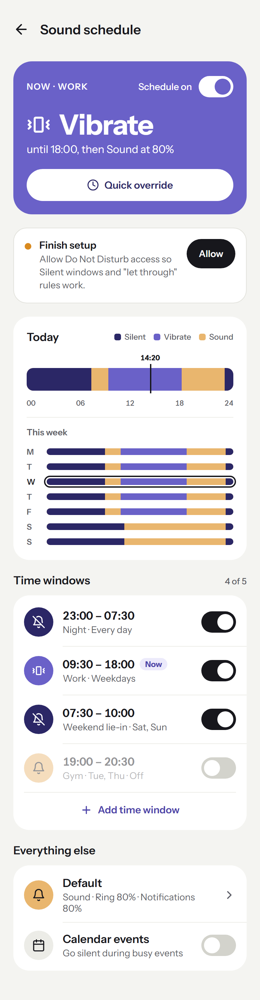
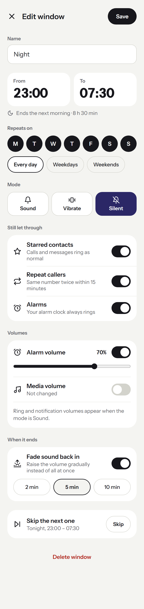
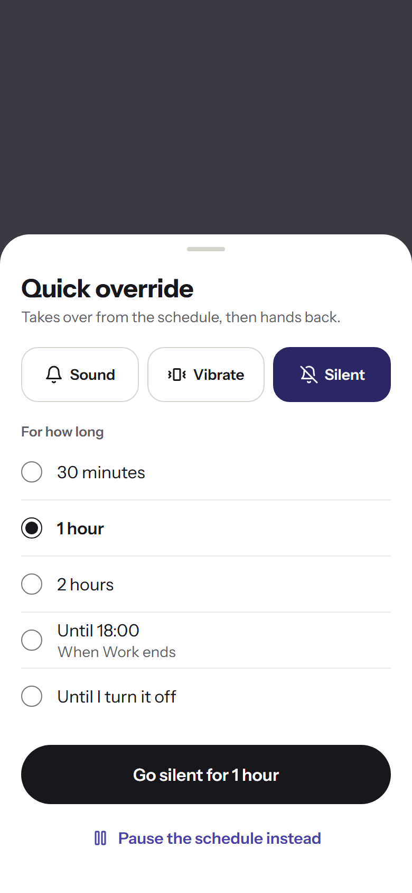
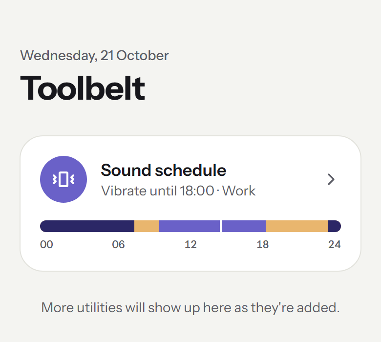
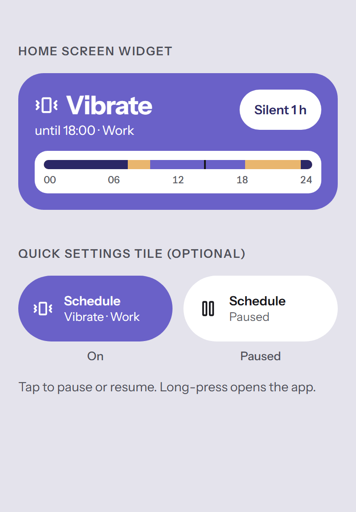

# Toolbelt

A small, battery-friendly Android app that collects everyday phone utilities in one place. No ads, no accounts, no tracking: it only talks to the internet to check GitHub for its own updates.

The first utility is **Sound schedule**. More will be added over time.

<p align="center">
  
  &nbsp;
  
  &nbsp;
  
</p>
<p align="center">
  
  &nbsp;
  
</p>
<p align="center"><sub>Design mockups; screenshots of the app itself are coming.</sub></p>

## Sound schedule

Set your phone to go quiet (or loud) on a timetable, with everything else handled automatically.

- **Time windows.** Up to five named windows, such as *Night 23:00 – 07:30, every day* or *Work 09:30 – 18:00, weekdays*. Each one can cross midnight and repeat on the days you pick. Windows can't overlap; the editor tells you exactly which window clashes.
- **Profiles.** Each window sets a mode (Sound, Vibrate or Silent) plus, optionally, ring, notification, alarm and media volume. Any volume you don't set is left alone.
- **Still let through.** While Silent, starred contacts, repeat callers and alarms can still ring.
- **Default profile.** Whatever applies when no window does.
- **Quick override.** Take over for 30 minutes, an hour, until the current window ends, or until you say so, then hand back to the schedule. Or pause the schedule entirely.
- **Calendar mode.** Optionally go Vibrate or Silent during events marked *busy* in your calendar.
- **Fade back in.** When a quiet window ends, raise the volume over 2, 5 or 10 minutes instead of all at once.
- **Skip the next one.** Skip a single occurrence (say, a holiday) without editing the window.
- **At a glance.** Today's timeline, a week view, a home-screen widget with a one-tap *Silent 1 h*, and an optional Quick Settings tile.

It doesn't run a background service. A single alarm wakes the app at the next change, applies the right profile, and arms the one after, so it uses essentially no battery. Volume changes you make by hand stick until the next scheduled change.

## Install

1. Download the latest `toolbelt-x.y.z.apk` from [Releases](https://github.com/VanshajR/toolbelt/releases/latest).
2. Open it on your phone and allow your browser or file manager to install apps when Android asks.
3. In Toolbelt, open **Sound schedule** and tap **Allow** on anything listed under *Finish setup*.

Requires Android 8.0 or later.

### Permissions

| Permission | Why |
| --- | --- |
| Do Not Disturb access | Switching to Silent and choosing what still gets through. Granted in system settings. |
| Alarms & reminders | Changes happen on the minute rather than a few minutes late. |
| Run at startup | Re-arms the schedule after a reboot. |
| Calendar (optional) | Only if you turn on calendar mode. Event details never leave the phone. |
| Notifications | Telling you when an update is out. |
| Install apps | Installing Toolbelt's own updates. |
| Internet | Checking GitHub for updates. Nothing else is sent anywhere. |

Some phones (notably Samsung and Xiaomi) stop apps' alarms to save battery. If changes don't happen on time, set Toolbelt's battery usage to *Unrestricted*.

## Updates

Toolbelt checks this repository's releases once a day and notifies you when a new version is out. Tap **Update** in Settings to download and install it. Android 12 and later may install it without a prompt; otherwise Android shows one confirmation screen. You can turn automatic checks off in Settings.

Updates only install over an existing copy if both are signed with the same key, so every release is signed with the project's release key.

## Building from source

Open the project in [Android Studio](https://developer.android.com/studio) and press Run, or from a terminal:

```sh
gradle assembleDebug
```

Built with Kotlin and Jetpack Compose (Material 3). No third-party libraries beyond AndroidX.

### Project layout

```
app/src/main/java/com/utilityapp/
├── MainActivity.kt          App shell and navigation
├── Utilities.kt             The list of utilities shown on the home screen
├── settings/                Theme and app-wide settings
├── ui/                      Theme, shared components
├── update/                  Update checks and self-install
└── soundschedule/           The Sound schedule utility
    ├── Model.kt             Windows, profiles, overrides
    ├── SoundScheduler.kt    Works out what applies now and arms the next alarm
    ├── ProfileApplier.kt    Ringer mode, volumes, Do Not Disturb
    ├── ScheduleWidget.kt    Home-screen widget
    └── ScheduleTileService.kt  Quick Settings tile
```

### Adding a utility

1. Create a package for it under `app/src/main/java/com/utilityapp/`.
2. Write its screen and a small home-screen tile composable.
3. Add an entry to the `utilities` list in `Utilities.kt`.

## Releasing

1. Bump `versionCode` and `versionName` in `app/build.gradle.kts` and commit.
2. Tag and push: `git tag v1.1.0 && git push origin v1.1.0`.
3. The [Release workflow](.github/workflows/release.yml) builds, signs and publishes the APK.

The workflow needs four repository secrets: `KEYSTORE_BASE64` (the release keystore, base64-encoded), `KEYSTORE_PASSWORD`, `KEY_ALIAS` and `KEY_PASSWORD`. For local release builds, put the same details in a `keystore.properties` file at the project root:

```properties
storeFile=release.jks
storePassword=...
keyAlias=toolbelt
keyPassword=...
```

Both files are ignored by git. Keep a backup of the keystore: if it's lost, installed copies can't be updated and have to be reinstalled.

## License

[MIT](LICENSE)
